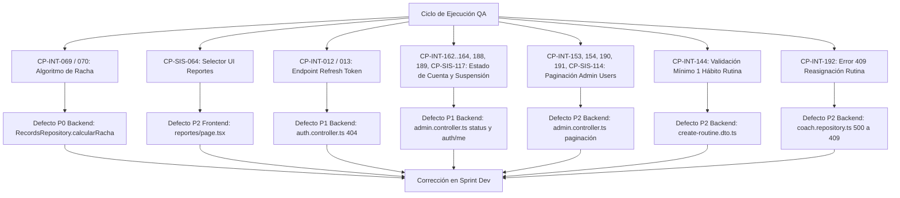

# Registro de Casos de Prueba Fallidos, Bloqueados y Defectos Técnicos (QA) — HabitApp

Este documento consolida el inventario formal de **casos de prueba que fallarán o quedarán bloqueados** durante el ciclo de ejecución de QA en el MVP de HabitApp (Web Next.js y Backend NestJS). Se documentan como **hallazgos reales de ingeniería y defectos de implementación**, diferenciándolos de errores en la especificación de pruebas, con el objetivo de facilitar su trazabilidad, resolución y enlace con Azure DevOps.

---

## 1. Resumen Ejecutivo de Casos Afectados

| Código Caso | HU Asociada | Tipo de Defecto | Severidad | Módulo / Capa | Causa Resumida | Estado QA | Azure DevOps ID |
|:---:|:---:|:---|:---:|:---|:---|:---:|:---:|
| **CP-INT-069** | US020 | Lógica de Negocio | **P0 (Crítico)** | Backend (`RecordsRepository`) | Racha rota en hábitos no diarios (compara con ayer calendario consecutivo y no con el día programado anterior). | **Fallará** | *[Por asignar]* |
| **CP-INT-070** | US020 | Lógica de Negocio | **P0 (Crítico)** | Backend (`RecordsRepository`) | Racha máxima distorsionada al saltar días de descanso programados. | **Fallará** | *[Por asignar]* |
| **CP-SIS-064** | US023 | Interfaz de Usuario | **P2 (Medio)** | Frontend (`/reportes/page.tsx`) | Selector de períodos muestra "Diario" en vez de "Anual"; bloquea el envío de `period=year` en pruebas UI. | **Bloqueado** | *[Por asignar]* |
| **CP-INT-012** | US004 | Funcionalidad Incompleta | **P1 (Alto)** | Backend (`AuthController`) | Endpoint `POST /api/v1/auth/refresh` no implementado (retorna 404 Not Found tras desacoplar Supabase Auth). | **Fallará** | *[Por asignar]* |
| **CP-INT-013** | US004 | Funcionalidad Incompleta | **P1 (Alto)** | Backend (`AuthController`) | Validación de refresh token revocado o expirado inexistente al faltar el endpoint de renovación. | **Fallará** | *[Por asignar]* |
| **CP-INT-162..164, 188, 189, CP-SIS-117** | US037 | Funcionalidad Incompleta / Seguridad | **P1 (Alto)** | Backend (`AdminController`, `AuthService`) | Endpoint `PATCH /admin/users/:id/status` no existe y falta validación de cuenta suspendida en login y sesión. | **Bloqueado** | *[Por asignar]* |
| **CP-INT-153, 154, 190, 191, CP-SIS-114** | US037 | Funcionalidad Incompleta | **P2 (Medio)** | Backend (`AdminController`, `UsersService`) | `GET /admin/users` retorna array plano sin query params (`page`, `limit`) ni metadatos de paginación (`meta`). | **Bloqueado** | *[Por asignar]* |
| **CP-INT-144** | US036 | Validación de Regla de Negocio | **P2 (Medio)** | Backend (`CreateRoutineDto`) | `habits` es `@IsOptional()`; permite crear rutinas vacías respondiendo 201 en vez de rechazar con 400 (mínimo 1 hábito). | **Bloqueado** | *[Por asignar]* |
| **CP-INT-192** | US036 | Manejo de Excepciones | **P2 (Medio)** | Backend (`CoachRepository`) | Violación de unicidad en `usuario_rutina` lanza `InternalServerErrorException` (500) en lugar de `ConflictException` (409). | **Bloqueado** | *[Por asignar]* |

---

## 2. Fichas Técnicas de Defectos y Casos Bloqueados



---

### Defecto 1: Falla en Cálculo de Rachas para Hábitos con Días Específicos
* **Casos de Prueba:** `CP-INT-069` y `CP-INT-070`
* **Historia de Usuario:** [US020](file:///home/kairos/Proyectos/habitapp/.docs/5-calidad-qa/historias_usuario_definitivas.md#L42) — Cálculo automático de rachas continuas (*Streaks*) (Riesgo: 9 - Alto)
* **Severidad:** **P0 — Crítico (Lógica de Dominio)**
* **Componente Afectado:** [`RecordsRepository.calcularRacha`](file:///home/kairos/Proyectos/habitapp-api/src/modules/habits/repositories/records.repository.ts#L225-L274) (`habitapp-api`)

#### Descripción del Problema
El método `calcularRacha` asume implícitamente que todos los hábitos se ejecutan de manera diaria (7 días a la semana). Para verificar si la racha actual sigue viva, compara la fecha del último registro contra el día de hoy (`hoyStr`) o el día de ayer natural (`ayerStr`), y luego itera hacia atrás restando exactamente 86,400,000 ms (1 día natural).

Si un usuario tiene un hábito configurado para días específicos (por ejemplo: **Lunes, Miércoles y Viernes**):
1. El usuario completa el hábito el lunes.
2. El miércoles por la mañana (antes o después del check-in), el registro completado anterior inmediato corresponde al **lunes**.
3. El cálculo evalúa si el último registro fue hoy (miércoles) o ayer (martes). Como fue el lunes, concluye erróneamente que la racha se rompió y la reinicia a `0` (o `1` si marcó hoy), perdiendo todo el historial consecutivo del cronograma.

#### Fragmento de Código con Causa Raíz
```typescript
// habitapp-api/src/modules/habits/repositories/records.repository.ts
const hoyStr = this.getLocalHoy(tzOffset);
const ayerDate = new Date(new Date(hoyStr + "T12:00:00Z").getTime() - 86400000);
const ayerStr = ayerDate.toISOString().split("T")[0];

let rachaActual = 0;

// ERROR: Compara únicamente contra ayer natural de calendario
if (registros[0].fecha !== hoyStr && registros[0].fecha !== ayerStr) {
  rachaActual = 0;
} else {
  // ERROR: Asume saltos de 1 día natural consecutivo (i * 86400000)
  const fechaBase = new Date(registros[0].fecha + 'T00:00:00Z'); 
  for (let i = 0; i < registros.length; i++) {
    const fechaEsperada = new Date(fechaBase.getTime() - i * 86400000);
    if (registros[i].fecha === fechaEsperada.toISOString().split('T')[0]) {
      rachaActual++;
    } else {
      break;
    }
  }
}
```

#### Comportamiento Esperado (Criterio US020)
Para hábitos con `dias_semana` definidos (ej. `[1, 3, 5]` para Lun-Mié-Vie), la fecha anterior válida esperada no es ayer (`hoy - 1 día`), sino el **día programado anterior**. El conteo de racha debe mantenerse intacto en los días de descanso no programados (martes, jueves, fines de semana).

#### Plan de Corrección
1. Consultar la configuración del hábito (`habitos.dias_semana` y `frecuencia`) dentro de `calcularRacha`.
2. Si `dias_semana` contiene una lista específica de días:
   - Calcular la fecha programada previa válida hacia atrás retrocediendo en el calendario hasta encontrar un día de la semana permitido.
   - Validar la racha contra la secuencia de días programados en lugar de días naturales consecutivos.
3. Actualizar `rachaMaxima` con la misma lógica de saltos permitidos.

---

### Defecto 2: Selector de Período en Reportes Desalineado con la API
* **Caso de Prueba:** `CP-SIS-064`
* **Historia de Usuario:** [US023](file:///home/kairos/Proyectos/habitapp/.docs/5-calidad-qa/historias_usuario_definitivas.md#L45) — Análisis editorial y reportes de progreso (`/reportes`) (Riesgo: 4 - Medio)
* **Severidad:** **P2 — Medio (Bloqueo de Prueba de Interfaz de Usuario)**
* **Componente Afectado:** [`src/app/(dashboard)/reportes/page.tsx`](file:///home/kairos/Proyectos/habitapp/src/app/(dashboard)/reportes/page.tsx#L51-L64) (`habitapp`)

#### Descripción del Problema
La API del Backend en el módulo de reportes (`GET /api/v1/users/reports`) admite los parámetros canónicos `period = week | month | year` (por defecto `week`). Sin embargo, el componente frontend renderiza un toggle estático con las etiquetas `["Diario", "Semanal", "Mensual"]`.

Consecuencias:
1. No existe botón ni opción en la UI para seleccionar el período **Anual** (`year`), bloqueando la ejecución del caso de prueba de sistema `CP-SIS-064`.
2. La opción *"Diario"* no tiene soporte en el controlador del backend para el reporte editorial acumulativo.

#### Fragmento de Código con Causa Raíz
```tsx
// habitapp/src/app/(dashboard)/reportes/page.tsx líneas 51-64:
<div className="flex items-center bg-white dark:bg-[#111827] rounded-xl border border-slate-200 dark:border-slate-800 p-1 shadow-sm">
  {["Diario", "Semanal", "Mensual"].map((p, i) => (
    <button
      key={p}
      className={`px-4 py-2 text-xs font-semibold rounded-lg transition-all ${
        i === 1
          ? "bg-indigo-600 text-white shadow-lg"
          : "text-slate-400 hover:text-slate-200"
      }`}
    >
      {p}
    </button>
  ))}
</div>
```

#### Comportamiento Esperado
* El selector de vista debe renderizar las opciones: `Semanal`, `Mensual` y `Anual`.
* Cada botón debe disparar de forma reactiva la recarga de datos pasando el query parameter correspondiente: `?period=week`, `?period=month`, `?period=year`.

#### Plan de Corrección
1. Modificar el arreglo de opciones en `page.tsx` (o su client component subordinado) a:
   ```typescript
   const periodos = [
     { label: 'Semanal', value: 'week' },
     { label: 'Mensual', value: 'month' },
     { label: 'Anual',   value: 'year' },
   ];
   ```
2. Vincular el estado activo y disparar la llamada al Server Action / API con el parámetro `value`.

---

### Defecto 3: Ausencia de Endpoint para Renovación de Tokens JWT
* **Casos de Prueba:** `CP-INT-012` y `CP-INT-013`
* **Historia de Usuario:** [US004](file:///home/kairos/Proyectos/habitapp/.docs/5-calidad-qa/historias_usuario_definitivas.md#L25) — Persistencia de sesión con auto-refresh de JWT (Riesgo: 6 - Alto)
* **Severidad:** **P1 — Alto (Funcionalidad Pendiente / Contrato Incompleto)**
* **Componente Afectado:** [`AuthController`](file:///home/kairos/Proyectos/habitapp-api/src/modules/auth/controllers/auth.controller.ts) (`habitapp-api`)

#### Descripción del Problema
Durante la migración arquitectónica donde se desacopló Supabase Auth para centralizar el flujo en la API propia de NestJS, se implementaron `POST /auth/register`, `POST /auth/login`, `POST /auth/logout`, `POST /auth/google`, `POST /auth/facebook`, pero quedó pendiente el endpoint de refresco de credenciales `POST /api/v1/auth/refresh`.

Actualmente:
* La sesión web funciona apoyándose en una cookie de larga duración (7 días), pero cuando un cliente (especialmente la aplicación móvil Flutter o un cliente API que requiera rotación periódica) intenta solicitar la renovación del JWT con su refresh token, recibe una respuesta HTTP `404 Not Found`.
* `CP-INT-012` (renovación exitosa con refresh token válido) y `CP-INT-013` (rechazo de renovación con token revocado/expirado) fallarán de forma inmediata en pruebas de integración.

#### Comportamiento Esperado
* `POST /api/v1/auth/refresh` debe recibir el refresh token (por cookie HTTP-only o en el cuerpo `{ refreshToken }`).
* Si el token es válido y no ha sido revocado en base de datos/lista negra, devolver un nuevo JWT con vigencia renovada (`200 OK`).
* Si el token es inválido o expiró, devolver `401 Unauthorized` obligando al reautenticado limpio.

#### Plan de Corrección
1. Agregar el endpoint en `AuthController`:
   ```typescript
   @Post('refresh')
   @HttpCode(HttpStatus.OK)
   @ApiOperation({ summary: 'Renovar access token JWT' })
   async refresh(@Req() req: any, @Body('refreshToken') bodyToken?: string) {
     const token = req.cookies?.refresh_token || bodyToken;
     return this.authService.refreshToken(token);
   }
   ```
2. Implementar la validación y emisión en `AuthService` y `JwtService`.

---

### Defecto 4: Ausencia de Endpoint para Cambio de Estado de Cuenta (`status`) y Verificación de Cuentas Suspendidas
* **Casos de Prueba:** `CP-INT-162`, `CP-INT-163`, `CP-INT-164`, `CP-INT-188`, `CP-INT-189`, `CP-SIS-117`
* **Historia de Usuario:** [US037](file:///workspaces/habitapp-workspace/habitapp/.docs/5-calidad-qa/historias_usuario_definitivas.md#L59) — Panel de administración, gestión de usuarios y roles (Riesgo: 6 - Alto)
* **Severidad:** **P1 — Alto (Control de Acceso y Funcionalidad Administrativa)**
* **Componente Afectado:** `AdminController` (`src/modules/admin/controllers/admin.controller.ts`), `AuthService` (`src/modules/auth/services/auth.service.ts`), `UsersService` (`src/modules/users/services/users.service.ts`) (`habitapp-api`)

#### Descripción del Problema
1. En `AdminController`, solo existe la ruta `PATCH users/:id/role`. No existe un endpoint para actualizar el estado de cuenta de los usuarios (`PATCH /api/v1/admin/users/:id/status`), impidiendo suspender, activar o poner en pendiente las cuentas desde la interfaz administrativa (`CP-INT-162`, `CP-SIS-117`).
2. No existe validación de catálogo para el campo `estado_cuenta` (`'Pendiente' | 'Activo' | 'Suspendido'`). Si se enviase un valor no contemplado como `"Baneado"`, debe ser rechazado con HTTP `400 Bad Request` por `ValidationPipe` (`CP-INT-188`).
3. En la autenticación e inicio de sesión (`POST /api/v1/auth/login`), no se evalúa si el usuario que intenta autenticarse posee `estado_cuenta === 'Suspendido'`. Debería rechazarse inmediatamente con HTTP `403 Forbidden` (`CP-INT-163`).
4. En las peticiones autenticadas subsiguientes (`GET /api/v1/users/me`), un usuario cuya cuenta haya sido suspendida en BD con sesión aún activa debe ser forzado a cerrar sesión y recibir HTTP `403 Forbidden` (`CP-INT-164`).

#### Comportamiento Esperado
* `PATCH /api/v1/admin/users/:id/status` accesible solo para administradores (`Roles(UserRole.ADMIN)`), validando con DTO que `estado_cuenta` pertenezca al enum permitido y retornando `200 OK` con el perfil actualizado. Usuarios no admin reciben `403 Forbidden` (`CP-INT-189`).
* `POST /api/v1/auth/login` rechaza con `403 Forbidden` y el mensaje `"Tu cuenta se encuentra suspendida. Contacta al administrador."` si `estado_cuenta === 'Suspendido'`.
* El guard o servicio de usuario valida en cada petición sensible o consulta de `/users/me` que el usuario no esté suspendido.

#### Plan de Corrección
1. Crear `UpdateUserStatusDto` con `@IsEnum(UserAccountStatus)` y mensaje descriptivo de validación.
2. Agregar endpoint `PATCH users/:id/status` en `AdminController` delegando a `usersService.updateUserStatus`.
3. En `AuthService.login` y `UsersService.getProfile`, verificar `estado_cuenta` y lanzar `ForbiddenException` con el mensaje correspondiente ante estado suspendido.

---

### Defecto 5: Ausencia de Paginación y Metadatos en Listado de Usuarios (`/admin/users`)
* **Casos de Prueba:** `CP-INT-153`, `CP-INT-154`, `CP-INT-190`, `CP-INT-191`, `CP-SIS-114`
* **Historia de Usuario:** [US037](file:///workspaces/habitapp-workspace/habitapp/.docs/5-calidad-qa/historias_usuario_definitivas.md#L59) — Panel de administración, gestión de usuarios y roles (Riesgo: 6 - Alto)
* **Severidad:** **P2 — Medio (Escalabilidad y Contrato de API Incompleto)**
* **Componente Afectado:** `AdminController.listUsers` (`src/modules/admin/controllers/admin.controller.ts`), `UsersService` y `UsersRepository` (`habitapp-api`)

#### Descripción del Problema
El endpoint `GET /api/v1/admin/users` consume directamente `usersService.listProfiles()`, el cual ejecuta una consulta `select('*')` sin parámetros de paginación ni ordenamiento. Retorna un array plano `[UserProfileDto]` con todos los usuarios existentes en la base de datos.

Consecuencias:
1. Ignora los query parameters canónicos `?page=1&limit=10` exigidos por la especificación de arquitectura y los casos `CP-INT-153`, `154`, `190` y `CP-SIS-114`.
2. No entrega la envoltura de metadatos `meta: { total, page, limit, totalPages }`, rompiendo el contrato estándar de APIs paginadas y bloqueando el funcionamiento de los controles de paginación en la tabla web `/admin`.
3. No valida parámetros `<= 0` (ej. `page=0` o `limit=0`), omitiendo el código HTTP `400 Bad Request` esperado en `CP-INT-191`.

#### Comportamiento Esperado
* `GET /api/v1/admin/users?page=1&limit=10` debe retornar un objeto estructurado:
  ```json
  {
    "data": [ ... ],
    "meta": {
      "total": 24,
      "page": 1,
      "limit": 10,
      "totalPages": 3
    }
  }
  ```
* Si se solicita una página superior a `totalPages` (ej. `page=99`), retorna `200 OK` con `data: []` y los metadatos correspondientes (`CP-INT-154`).
* Si se envían `page=0` o `limit=0`, `ValidationPipe` rechaza la petición con `400 Bad Request` (`CP-INT-191`).

#### Plan de Corrección
1. Crear o reutilizar `PaginationQueryDto` con `@Type(() => Number)`, `@IsInt()`, `@Min(1)`.
2. Actualizar `AdminController.listUsers(@Query() query: PaginationQueryDto)`.
3. Actualizar `UsersRepository.listProfilesPaginated(page, limit)` usando `.range((page - 1) * limit, page * limit - 1)` y `{ count: 'exact' }` en Supabase.

---

### Defecto 6: Omisión de Restricción de Mínimo 1 Hábito en Creación de Rutinas
* **Caso de Prueba:** `CP-INT-144`
* **Historia de Usuario:** [US036](file:///workspaces/habitapp-workspace/habitapp/.docs/5-calidad-qa/historias_usuario_definitivas.md#L58) — Creación y asignación de rutinas maestras por entrenador (Riesgo: 6 - Alto)
* **Severidad:** **P2 — Medio (Regla de Negocio en DTO)**
* **Componente Afectado:** `CreateRoutineDto` (`src/modules/coach/dto/create-routine.dto.ts`) (`habitapp-api`)

#### Descripción del Problema
En `CreateRoutineDto`, la propiedad `habits` está decorada como `@IsOptional()`. Esto permite que una petición `POST /api/v1/coach/routines` con cuerpo `{ "name": "Rutina Vacía", "habits": [] }` o sin la propiedad `habits` sea aceptada y registrada en la base de datos con respuesta HTTP `201 Created`.

#### Comportamiento Esperado (Criterio US036.1 / CP-INT-144)
Una rutina modelo debe contener obligatoriamente al menos **1 hábito**. Si el arreglo de hábitos viene vacío (`[]`) o ausente, la API debe rechazar la solicitud con HTTP `400 Bad Request` y un mensaje descriptivo de validación.

#### Plan de Corrección
1. En `create-routine.dto.ts`, reemplazar `@IsOptional()` por:
   ```typescript
   @ApiProperty({
     description: 'Hábitos incluidos en la rutina (mínimo 1)',
     type: [CreateRoutineHabitDto],
   })
   @IsArray()
   @ArrayMinSize(1, { message: 'La rutina debe contener al menos un hábito.' })
   @ValidateNested({ each: true })
   @Type(() => CreateRoutineHabitDto)
   habits: CreateRoutineHabitDto[];
   ```

---

### Defecto 7: Error 500 en Lugar de 409 Conflict al Asignar Rutina Duplicada a un Cliente
* **Caso de Prueba:** `CP-INT-192`
* **Historia de Usuario:** [US036](file:///workspaces/habitapp-workspace/habitapp/.docs/5-calidad-qa/historias_usuario_definitivas.md#L58) — Creación y asignación de rutinas maestras por entrenador (Riesgo: 6 - Alto)
* **Severidad:** **P2 — Medio (Mapeo de Errores y Manejo de Excepciones)**
* **Componente Afectado:** `CoachRepository.assignRoutineToClient` (`src/modules/coach/repositories/coach.repository.ts`) (`habitapp-api`)

#### Descripción del Problema
La base de datos cuenta con una restricción de unicidad en la tabla `seguimiento.usuario_rutina`. Cuando un entrenador intenta asignar por segunda vez una rutina que el cliente ya tiene asignada:
1. PostgreSQL rechaza la inserción arrojando el código de error `23505` (`unique_violation`).
2. En `CoachRepository.assignRoutineToClient`:
   ```typescript
   if (error) {
     throw new InternalServerErrorException(`Failed to assign routine to client: ${error.message}`);
   }
   ```
3. El backend responde con HTTP `500 Internal Server Error`, lo cual enmascara una condición esperada de negocio y vulnera el principio de que los errores de entrada/conflicto del cliente deben mapearse en la familia `4xx`.

#### Comportamiento Esperado (Criterio US036.2 / CP-INT-192)
La API debe interceptar el conflicto de asignación duplicada y devolver HTTP `409 Conflict` (o alternativamente `400 Bad Request`) con el mensaje:
`"El cliente ya tiene asignada esta rutina actualmente."`, impidiendo la duplicación sin fallar internamente.

#### Plan de Corrección
1. En `coach.repository.ts`, evaluar el código de error de Supabase/PostgreSQL:
   ```typescript
   if (error) {
     if (error.code === '23505') {
       throw new ConflictException('El cliente ya tiene asignada esta rutina actualmente.');
     }
     throw new InternalServerErrorException(`Failed to assign routine to client: ${error.message}`);
   }
   ```

---

## 3. Matriz de Priorización para el Sprint de Corrección

```
      Impacto en Calidad
         ▲
      P0 │  [CP-INT-069, CP-INT-070]
         │  (Rachas en hábitos L-M-V)
         │
      P1 │  [CP-INT-012, CP-INT-013]    [CP-INT-162..164, 188, 189, CP-SIS-117]
         │  (POST /auth/refresh)        (Estado de cuenta y suspensión)
         │
      P2 │  [CP-SIS-064]                [CP-INT-144]   [CP-INT-192]   [CP-INT-153..154, 190, 191, CP-SIS-114]
         │  (Selector en Reportes)      (Mín 1 hábito) (Error 409)    (Paginación /admin/users)
         └─────────────────────────────────────────────────────────────────────────────► Esfuerzo de Corrección
             Bajo                       Medio                         Alto
```

### Orden de Ejecución Sugerido:
1. **Inmediato (Fixes Frontend y DTOs P2 - Esfuerzo < 1 hora):**
   - Corregir el selector en `src/app/(dashboard)/reportes/page.tsx` (`CP-SIS-064`).
   - Agregar `@ArrayMinSize(1)` en `CreateRoutineDto` (`CP-INT-144`).
   - Mapear error `23505` a `ConflictException` (409) en `CoachRepository.assignRoutineToClient` (`CP-INT-192`).
2. **Prioridad 1 (Backend P1 - Esfuerzo ~3 horas):**
   - Implementar `POST /api/v1/auth/refresh` en `AuthController` y `AuthService` (`CP-INT-012`, `CP-INT-013`).
   - Implementar `PATCH /api/v1/admin/users/:id/status` y verificación de `estado_cuenta === 'Suspendido'` en login y sesión (`CP-INT-162..164, 188, 189, CP-SIS-117`).
3. **Prioridad 2 (Backend P2 - Esfuerzo ~2 horas):**
   - Implementar paginación con metadatos `meta` en `AdminController.listUsers` (`CP-INT-153, 154, 190, 191, CP-SIS-114`).
4. **Prioridad 0 (Lógica Core P0 - Esfuerzo ~3 horas):**
   - Refactorizar el algoritmo en `RecordsRepository.calcularRacha` integrando el salto de días según `dias_semana` (`CP-INT-069`, `CP-INT-070`).

---

## 4. Puntos Menores a Resolver Durante la Ejecución (No Bloqueantes)

Los siguientes tres aspectos no impiden la entrega de la especificación ni bloquean el flujo principal de pruebas; se formalizan para su resolución y validación en el momento de la ejecución:

### 1. Validación de Fortaleza de Contraseña en Recuperación (US005.3 / CP-INT-017)
* **Situación:** En la historia [US005](file:///home/kairos/Proyectos/habitapp/.docs/5-calidad-qa/historias_usuario_definitivas.md#L26) (Recuperación y restablecimiento de contraseña), el criterio US005.3 menciona "validación de fortaleza de la nueva clave".
* **Definición Asumida para QA:** Se aplica la misma regla de partición y valores límite establecida para el registro ([US002](file:///home/kairos/Proyectos/habitapp/.docs/5-calidad-qa/historias_usuario_definitivas.md#L23)):
  * **Partición válida:** Longitud entre 6 y 50 caracteres inclusivo.
  * **Particiones inválidas:** Longitud < 6 caracteres o > 50 caracteres.
* **Acción:** Confirmar con el equipo si se añadirá algún requisito de caracteres especiales/complejidad adicional en una fase posterior o si se mantiene la regla estándar de 6 a 50 caracteres.

### 2. Responsabilidad del Cálculo de la Barra de Progreso (CP-INT-062 y CP-INT-063)
* **Situación:** Determinar si el cálculo del porcentaje de hábitos completados del día (0 a 100%) corresponde a la API o al Frontend.
* **Estado en Código:**
  * En la interfaz web, el componente [`DailyProgress.tsx`](file:///home/kairos/Proyectos/habitapp/src/components/registros/DailyProgress.tsx#L13-L15) realiza el cálculo directamente en el cliente:
    ```typescript
    const porcentaje = total === 0 ? 0 : Math.round((completados / total) * 100);
    ```
* **Acción:** Si se confirma que la API solo suministra las cantidades brutas (`completados` y `total`) y el cálculo matemático reside exclusivamente en el cliente, los casos `CP-INT-062` y `CP-INT-063` pasarán formalmente de pruebas de integración de API a **pruebas unitarias de componente en el frontend**.

### 3. Invalidación de JWT en Servidor tras Logout (CP-INT-027)
* **Situación:** En [US010](file:///home/kairos/Proyectos/habitapp/.docs/5-calidad-qa/historias_usuario_definitivas.md#L31) y el caso `CP-INT-027` se evalúa si un token JWT puede reutilizarse después de que el usuario cerró sesión.
* **Estado en Código:**
  * [`AuthController.logout`](file:///home/kairos/Proyectos/habitapp-api/src/modules/auth/controllers/auth.controller.ts) ejecuta `res.clearCookie('access_token')`.
  * La API opera bajo arquitectura **JWT Stateless** estándar sin tabla de revocación o lista negra en Redis/BD.
* **Comportamiento en Prueba:** Si la prueba reutiliza el token JWT crudo mediante el header `Authorization: Bearer <token>` tras el logout, el backend lo aceptará como válido hasta su fecha de expiración natural.
* **Acción:** Se deja constancia de que si `CP-INT-027` falla por esta razón, **representa un hallazgo real de arquitectura de seguridad / persistencia** (ausencia de blacklist de tokens revocados en servidor) y **no un defecto de diseño de la especificación de pruebas**.

---

## 5. Acuerdos y Definiciones Técnicas de Módulos (Comunidad, Retos y Hábitos)

Esta sección recopila las decisiones de arquitectura y consensos técnicos alcanzados para el diseño y ejecución de los casos de prueba de los módulos de Comunidad y Hábitos:

### 1. Clonación de Hábitos Comunitarios en 1 Clic (US031 / CP-INT-116 vs CP-SIS)
* **Arquitectura de Ejecución:**
  * **En el Navegador (Pruebas de Sistema / UI - F12 Red):** La interfaz Next.js dispara la Server Action [`clonarHabitoAction`](file:///home/kairos/Proyectos/habitapp/src/actions/comunidad.actions.ts#L145) registrando en la pestaña Red una petición `POST http://localhost:3000/comunidad` (`Content-Type: text/x-component`, cabecera `Next-Action`).
  * **En el Backend (Pruebas de Integración de API):** En el servidor de Next.js, la acción invoca de servidor a servidor el endpoint dedicado de NestJS:
    `POST /api/v1/users/community/habitos/:id/clonar` ([`ComunidadController.cloneHabit`](file:///home/kairos/Proyectos/habitapp-api/src/modules/community/controllers/community.controller.ts#L253-L263)).
* **Criterio de Trazabilidad:**
  * `CP-INT-116` (Integración): Valida la ruta REST `POST /api/v1/users/community/habitos/:id/clonar` en Postman/Jest (verifica `201 Created`, incremento de `clones_count` e inserción en la cuenta del usuario).
  * `CP-SIS-xxx` (Sistema): Valida la interacción completa en la UI (clic en botón "Clonar" en `/comunidad` -> Server Action `POST /comunidad` -> Toast de confirmación -> hábito visible en `/dashboard` y `/habitos`).

### 2. Solicitud de Sesión con Especialista (US034 / CP-INT-134)
* **Comportamiento Técnico:** El botón "Agendar cita" en la tarjeta y "Confirmar solicitud de sesión" en el modal de especialista ([`ComunidadInteractiveView.tsx` L1255 y L1738](file:///home/kairos/Proyectos/habitapp/src/components/comunidad/ComunidadInteractiveView.tsx)) ejecutan exclusivamente interacción en cliente (`showToast(...)`).
* **Criterio QA:** No se dispara ninguna petición HTTP de red hacia la API. El caso de prueba se mantiene evaluando el feedback in-app (notificación/toast en pantalla) sin requerir petición REST.

### 3. Regla Límite de Fecha Fin del Reto (US032)
* **Comportamiento Técnico:** En [`CommunityRepository.ts`](file:///home/kairos/Proyectos/habitapp-api/src/modules/community/repositories/community.repository.ts), la validación de expiración evalúa `reto.fechafin < today`.
* **Criterio QA:** El día exacto de la fecha fin **SÍ permite check-in** (es inclusivo hasta las 23:59:59 de ese día). Un reto solo se considera caducado a partir del día siguiente (`fechafin + 1 día`). El caso de valor límite con fecha "hoy" es válido y debe resultar aprobado.

### 4. Mapeo de Reacciones en Comunidad (US030)
* **Comportamiento Técnico:** La API admite tres tipos: `'Me gusta' | 'Me motiva' | 'Util'` en `POST /api/v1/users/community/:targetType/:id/reacciones`.
* **Criterio QA:** El icono de corazón en la interfaz de usuario corresponde de forma unívoca a la reacción de tipo `'Me gusta'`.

### 5. Requisitos Aprobados para Fixtures de Datos de Prueba (Sección 9)
Para la ejecución de pruebas sintéticas del módulo de comunidad se definen cuatro fixtures obligatorios:
1. **Foros:** Al menos 2 foros en categorías distintas (ej. *Nutrición* y *Ejercicio*).
2. **Comentarios:** 1 foro con mínimo 3 comentarios para auditar hilos y conteo.
3. **Retos:** 1 reto activo (`fechafin >= hoy`) y 1 reto caducado (`fechafin < hoy`).
4. **Participación:** 1 usuario registrado e inscrito en un reto de 3 días con avance registrado del Día 1.

---

*Nota de QA: Al momento de registrar los Work Items formales de Bug en Azure DevOps, reemplácese `[Por asignar]` con el ID correspondiente (ej. `AB#1042`, `AB#1043`).*


